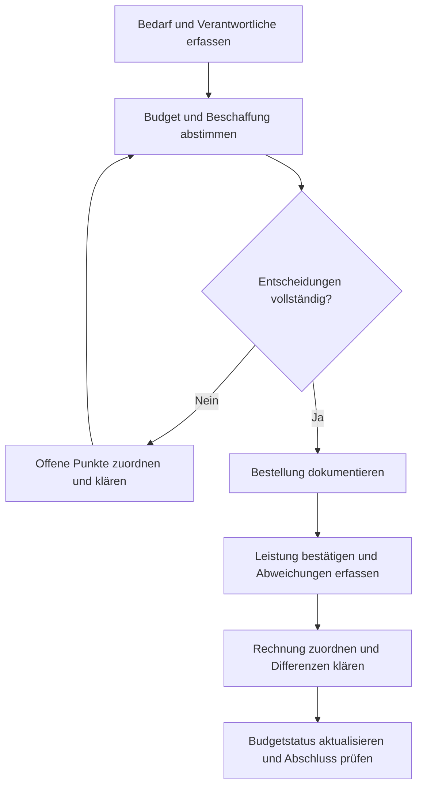

# Vom Bedarf zum nachvollziehbaren Budgetabschluss

## 1. Ausgangsproblem

Ein Fachbereich spricht von einer freigegebenen Ausgabe, Finance sieht keine zugeordnete Budgetfreigabe und im System steht bereits ein abgeschlossener Vorgang. Jede Person kann einen Teil des Vorgangs erklären, aber die Informationen passen nicht zusammen.

Das Ziel dieses Leitfadens ist eine gemeinsame Sicht: Was wurde gewünscht, was freigegeben, was beauftragt, was erbracht und was tatsächlich abgerechnet?

## 2. Informationen zuerst ordnen

Für jeden Vorgang wird eine gemeinsame Referenz verwendet. Wenn CRM, Bestellsystem und Buchhaltung eigene IDs besitzen, wird ihre Zuordnung dokumentiert. Eine gemeinsame Referenz bedeutet nicht, vertrauliche Informationen in jedem System zu duplizieren.

| Informationsbereich | Zu klärende Fragen | Mögliches Ergebnis |
| --- | --- | --- |
| Bedarf | Was wird benötigt, wofür und bis wann? | Abgestimmte Leistungsbeschreibung |
| Verantwortung | Wer fordert an, wer entscheidet und wer bestätigt die Leistung? | Benannte Zuständigkeiten |
| Budget | Welches Budget und welche Periode sind betroffen? | Budgetreferenz und zuständige Entscheidung |
| Beschaffung | Wer liefert welche Leistung zu welchen Bedingungen? | Abgestimmtes Angebot und Bestellbezug |
| Durchführung | Was wurde tatsächlich geliefert oder erbracht? | Fachliche Leistungsbestätigung oder dokumentierte Abweichung |
| Abrechnung | Welche Rechnung bezieht sich auf welche Leistung und Bestellung? | Nachvollziehbare Zuordnung und Klärung von Differenzen |
| Abschluss | Welche Bedingungen müssen für den fachlichen Abschluss erfüllt sein? | Definierter Abschlussstatus mit offenen Punkten |

## 3. Einen gemeinsamen Ablauf definieren

Die Reihenfolge ist ein Arbeitsmodell, keine universelle Unternehmensrichtlinie. In der Praxis können Freigaben parallel erfolgen oder zusätzliche Schritte erforderlich sein.

### Schritt A: Bedarf beschreiben

Der Fachbereich beschreibt Zweck, Umfang, Termin und gewünschtes Ergebnis. Eine Bezeichnung wie „Retail-Unterstützung“ reicht häufig nicht, um ein Angebot, die Leistung und die Rechnung später miteinander zu vergleichen.

**Hilfreiches Ergebnis:** „Aufbau und Betreuung von zwei Demonstrationsflächen an festgelegten Terminen, mit dokumentierter Abnahme durch die Projektverantwortliche.“

### Schritt B: Budget und Zuständigkeiten klären

Budgetverfügbarkeit, fachliche Zustimmung und Bestellfreigabe sind unterschiedliche Informationen. Gemeinsam wird festgelegt, wer welche Entscheidung trifft und welcher Nachweis im Ablauf erforderlich ist.

Für ein Team in Europa und eine Zentrale in China sollten außerdem dieselben Begriffe, Betragsgrundlagen, Zeiträume und Statusdefinitionen verwendet werden. Ein englisches Wort wie „approved“ ersetzt keine gemeinsame Definition dessen, was tatsächlich freigegeben wurde.

### Schritt C: Bestellung auf die Freigabe beziehen

Die Bestellung wird mit der abgestimmten Leistung und der relevanten Freigabeversion verknüpft. Bei Änderungen an Umfang, Betrag oder Lieferant wird geklärt, ob bestehende Entscheidungen weiterhin gelten oder erneut getroffen werden müssen.

### Schritt D: Leistung und Rechnung zusammenführen

Die zuständige Fachperson bestätigt, was tatsächlich erbracht wurde. Die Rechnung wird anschließend dem Vorgang zugeordnet. Differenzen werden mit einer verantwortlichen Person und einer offenen Entscheidung erfasst.

**Wichtig für die Prozesslogik:** Eine Rechnung allein ist keine fachliche Leistungsbestätigung. Ein bezahlter Vorgang beweist ebenfalls nicht, dass alle fachlichen Fragen geklärt sind.

### Schritt E: Budgetinformationen konsistent aktualisieren

Angefragte, genehmigte, bestellte, gebuchte und bezahlte Beträge werden getrennt bezeichnet. Die gemeinsame Auswertung muss festlegen, welche Werte sie für welchen Zweck verwendet.

Wenn ein Bestellbetrag durch einen gebuchten Rechnungsbetrag abgelöst wird, darf er in derselben Gesamtsumme nicht zusätzlich als unveränderte offene Verpflichtung stehen bleiben. Wie dieser Übergang abgebildet wird, ist mit Finance und den Systemverantwortlichen festzulegen.

## 4. Frei erfundenes Beispiel: Die Rechnung passt nicht zur Bestellung

Alle Beträge sind vereinfachte EUR-Beispielwerte ohne Steuerdarstellung.

| Information | Vorliegender Stand |
| --- | --- |
| Vorgangsreferenz | DEMO-RETAIL-01 |
| Verfügbarer Budgetrahmen vor dem Vorgang | 20.000 EUR |
| Freigegebener und bestellter Leistungsumfang | 10.000 EUR |
| Fachlich bestätigte Leistung | Umfang entsprechend der Bestellung |
| Eingegangene Rechnung | 11.000 EUR |
| CRM-Anzeige | „Erledigt“ |

**Was ist zuerst zu klären?**

1. Ist die zusätzliche Leistung tatsächlich beauftragt und erbracht worden?
2. Liegt eine genehmigte Änderung vor, die noch nicht mit dem Vorgang verknüpft ist?
3. Ist die Rechnung fehlerhaft oder die Leistungsbestätigung unvollständig?
4. Was bedeutet „Erledigt“ im CRM: Leistung erbracht, Rechnung geprüft oder Gesamtvorgang abgeschlossen?

**Die fachliche Entscheidung bleibt offen**, bis diese Fragen beantwortet sind. Das Beispiel legt weder eine automatische Rechnungskorrektur noch eine automatische Nachgenehmigung nahe.

**Möglicher Systembedarf nach der Klärung:** Unterschiedliche Status für Leistungsabschluss und Rechnungsprüfung, Verknüpfung einer Änderungsfreigabe und Anzeige des ungeklärten Differenzbetrags. Ob eine technische Sperre sinnvoll ist oder ein sichtbarer Warnhinweis genügt, hängt vom abgestimmten Prozess und Berechtigungskonzept ab.

## 5. Rollen ausdrücklich zuordnen

| Entscheidung | Zu benennende verantwortliche Rolle |
| --- | --- |
| Geschäftlicher Zweck und benötigter Umfang | Anfordernder Fachbereich |
| Verwendung eines Budgets | Budgetverantwortliche gemäß interner Regelung |
| Lieferant und Bestellbedingungen | Zuständige Beschaffungsfunktion |
| Tatsächlich erbrachte Leistung | Fachlich zuständige abnehmende Person |
| Rechnungszuordnung und weitere finanzielle Behandlung | Finance und weitere zuständige Rollen gemäß internem Ablauf |
| Technische Umsetzung | IT auf Grundlage freigegebener fachlicher Anforderungen |

Das ist keine feste Organisationsvorgabe. Kleine Unternehmen können Rollen bündeln; größere Unternehmen benötigen häufig eine andere Aufgabentrennung.

## 6. Häufige Fehlwege

- Einen uneindeutigen Status technisch nachbauen, ohne zuerst seine Bedeutung zu klären.
- Jede Rückfrage als IT-Fehler behandeln, obwohl eine fachliche Entscheidung fehlt.
- Änderungen nur per E-Mail abstimmen, ohne sie dem Vorgang zuzuordnen.
- Eine vereinfachte Budgetübersicht als Buchhaltungsabschluss interpretieren.
- Unterstellen, dass ein standardisierter Ablauf alle Ausnahmen abdeckt.

## 7. Wann der Ablauf ausreichend beschrieben ist

Eine andere beteiligte Person sollte anhand der Dokumentation erkennen können, was als Nächstes zu tun ist, wer darüber entscheidet, welche Information fehlt und welcher Systemstatus die tatsächliche Situation beschreibt.

Weiter: [IT-Anforderungen formulieren](02-business-it-requirements.md) oder [Bedarfsbriefing ausfüllen](templates/request-brief.md).
